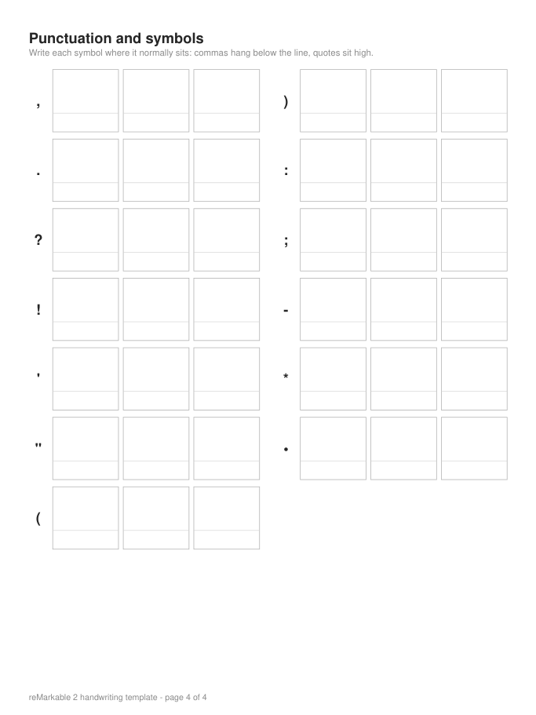

# Handwriting Notes App

A Python application that converts PowerPoint presentations and PDFs into personalized handwritten notes, using handwriting samples collected from a reMarkable 2 tablet.

You fill in a printable template on the tablet, export it as a PDF, and the app builds a personal handwriting profile from it. It can then write the text of any slide deck in that handwriting, on pages sized for the reMarkable 2.

It started as an accessibility project: a tool for students who cannot easily write notes by hand.

## Features

- **Template generator.** Makes a blank, four-page template (225 character boxes) sized for the reMarkable 2: uppercase, lowercase, digits, a sample sentence, and 13 punctuation marks and symbols. Coordinates and the PDF come from one layout definition, so they cannot drift apart.
- **Handwriting extraction.** Reads the filled-in PDF, crops every box, removes the printed borders and guides, and saves transparent glyph images with baseline metadata.
- **Spacing measurement.** Measures letter and word spacing from the handwritten sample sentence.
- **Slide text extraction.** Reads `.pptx` files directly. Reads text-based PDFs by inferring titles, bullets and indentation from the layout.
- **Handwritten rendering.** Writes text onto ruled pages with random glyph choice, small size and angle variation, baseline correction, handwritten punctuation, bullets and indentation. A fixed seed gives the same pages every time.
- **Streamlit app.** Upload slides, check and edit the extracted text, generate the PDF, preview it and download it. A second screen creates new handwriting profiles from a completed template.
- **Tolerant of reMarkable exports.** If the tablet grows a page's bounds because of a stray mark outside the page, the page is trimmed back to the template area in memory, but only when the printed boxes provably line up there. Otherwise the app explains how to export again. Your uploaded file is never modified.
- **Safe by design.** The app runs only on `localhost`, limits uploads to 50 MB, works in temporary folders, never overwrites an existing profile, and keeps your edits when you switch screens.

An older, three-page template (V1, letters and digits only) is still supported. Profiles made from it use a plain built-in font for punctuation.

## How it works

```
template.py      blank template PDF + template_layout.json
      |  (fill in on the reMarkable 2, export as PDF)
extract.py       completed PDF -> glyphs/<name>/*.png + glyph_metadata.json
spacing.py       sample sentence -> glyphs/<name>/style.json
      |
slides.py        .pptx / .pdf -> notes text (bullets as "* ...", indentation by spaces)
render.py        notes text + a profile -> handwritten multi-page PDF
      |
app.py           Streamlit screens;  app_core.py holds the app logic
```

Coordinates are PDF points with the origin at the bottom-left. Image pixels use a top-left origin; the conversion happens in one place in `extract.py`.

## Install

Python 3.11 or newer is required.

```bash
python -m venv .venv
source .venv/bin/activate
pip install -r requirements.txt
```

## Create your handwriting profile

Your handwriting never leaves your computer, and this repository contains none. You provide your own.

1. Generate or download the blank template: `python template.py` (writes `template.pdf`), or use the download button in the app.
2. Open it on your reMarkable 2 and write every character three times inside its box, then write the sample sentence on page 3.
3. Export the finished document as a PDF with all four pages at the original size.
4. Create the profile, either in the app (**Create a handwriting profile** screen) or from the command line:

```bash
python extract.py path/to/your_completed_template.pdf --user yourname
python spacing.py path/to/your_completed_template.pdf --user yourname
```

This creates `glyphs/yourname/`. The `glyphs/`, `samples/`, `slides_in/` and `output/` folders are ignored by Git on purpose.

## Run the app

```bash
streamlit run app.py
```

Then choose your profile, upload a `.pptx` or text-based `.pdf`, review the extracted text, and generate the handwritten PDF.

Command-line use:

```bash
python slides.py slides_in/deck.pptx --output output/deck_notes.txt
python render.py --input output/deck_notes.txt --user yourname --seed 1 --preview
python render.py --text "Hello, world!" --user yourname
```

## Run the tests

```bash
python -m unittest discover -s tests
```

The suite has 376 tests. On the author's machine, with private handwriting data and a real slide deck available, all 376 run and pass. On a fresh clone of this repository, 357 run and pass and 19 are skipped, because they need private files (a real handwriting profile, a completed reMarkable PDF and a real deck) that are deliberately not published. Everything else uses generated synthetic inputs, including the tests for the expanded-page export fix.

## Project layout

| File | Purpose |
|---|---|
| `config.py` | Every setting: device, template versions, layout, paths |
| `template.py`, `preview.py` | Template and layout generation, overlay previews |
| `extract.py`, `contact_sheet.py` | Glyph extraction and review sheets |
| `spacing.py`, `spacing_preview.py` | Spacing measurement and its diagnostic image |
| `slides.py`, `slides_pdf.py` | Slide and PDF text extraction |
| `render.py` | Handwritten page rendering |
| `app.py`, `app_core.py` | Streamlit interface and its logic |
| `templates/` | Blank V1 and V2 templates and layouts |
| `tests/` | Unit and interface tests with synthetic fixtures |

The blank template page for punctuation looks like this:



## Current limitations

- Letters are written one by one, not connected.
- Letter spacing and baseline variation are approximate measurements from one sample sentence.
- PowerPoint structure is read directly, but PDF structure (titles, bullets, indentation) is guessed. Only a few PDF exports have been tried.
- Text inside pictures, charts and SmartArt is not extracted. There is no OCR, so scanned PDFs cannot be read.
- Tuned for the reMarkable 2 (447 x 596 pt pages). Other devices need a new device profile in `config.py`.
- Handwritten punctuation works only for profiles made from the four-page template.

## Possible future work

- Connected (cursive) handwriting from stroke data.
- More PDF exporters and layouts tested.
- Other device profiles.
- Optional OCR for image-only slides.

## License

This project is open source under the [MIT License](LICENSE). You may use, copy, modify and redistribute the code, including for commercial purposes, as long as you keep the copyright and license notice.

The MIT License covers this project's own code only. The libraries it depends on keep their own licenses (installed versions checked with `pip`):

| Library | License |
|---|---|
| ReportLab | BSD |
| Pillow | MIT-CMU |
| NumPy | BSD-3-Clause |
| python-pptx | MIT |
| Streamlit | Apache-2.0 |
| PyMuPDF | AGPL-3.0, or a paid commercial license from Artifex |

PyMuPDF is the one to note: its AGPL terms apply when you distribute the combined application or offer it to others over a network. If that is your plan, review the [PyMuPDF licensing](https://pymupdf.readthedocs.io/en/latest/about.html#license-and-copyright) or obtain a commercial license. This is a summary, not legal advice.

Your own handwriting samples, completed templates and notes are not part of this repository and remain yours.
